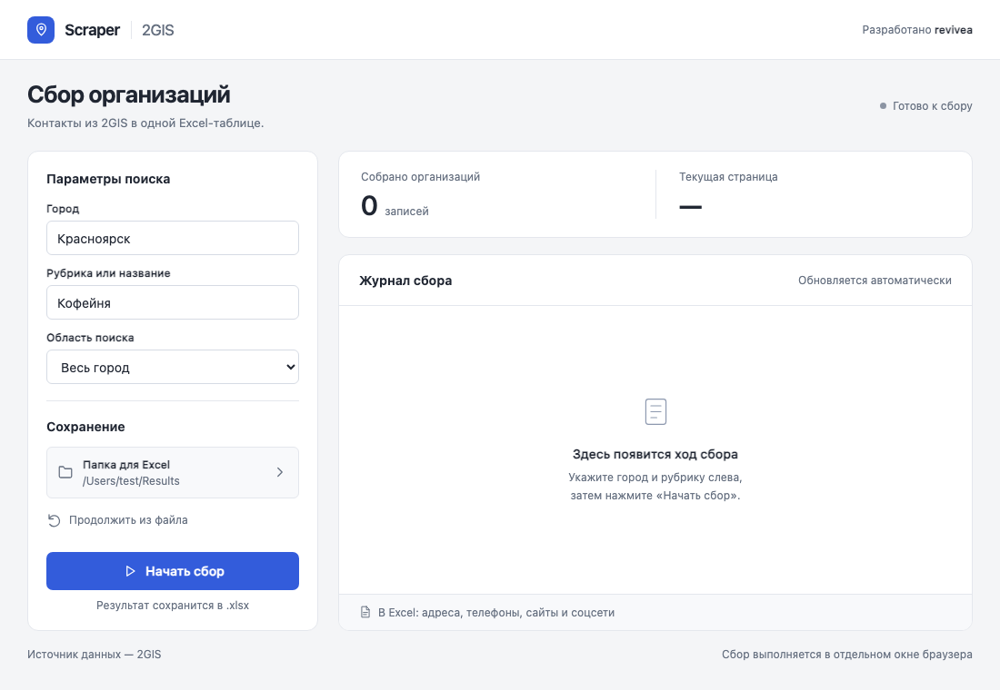

# Scraper 2GIS

Настольное приложение для сбора контактов организаций из 2GIS в Excel.
Поиск по городу, рубрике или названию, району и улице. Без ключей API и регистрации.



## Скачать

Готовые приложения доступны в [Releases](https://github.com/revivea0/Scraper2GIS-AutoBrowser/releases/latest).
Python для них не нужен.

| Устройство | Архив |
| --- | --- |
| Windows 10/11, Intel/AMD x64 | [Windows x64](https://github.com/revivea0/Scraper2GIS-AutoBrowser/releases/latest/download/Scraper2GIS-Windows-x64.zip) |
| Mac с Apple Silicon, macOS 15+ | [macOS arm64](https://github.com/revivea0/Scraper2GIS-AutoBrowser/releases/latest/download/Scraper2GIS-macOS-arm64.zip) |
| Mac с Intel, macOS 15+ | [macOS x64](https://github.com/revivea0/Scraper2GIS-AutoBrowser/releases/latest/download/Scraper2GIS-macOS-x64.zip) |
| Linux x64, Ubuntu 24.04 и совместимые | [Linux x64](https://github.com/revivea0/Scraper2GIS-AutoBrowser/releases/latest/download/Scraper2GIS-Linux-x64.tar.gz) |

Распакуйте архив целиком. Windows: запустите `Scraper2GIS/Scraper2GIS.exe`,
сохранив рядом папку `_internal`; нужен Edge WebView2 Runtime.
macOS: перенесите `Scraper2GIS.app` в «Программы».
Linux: запустите `Scraper2GIS/Scraper2GIS` из графического рабочего стола.
Сборки не подписаны: macOS может заблокировать первый запуск. Разрешайте запуск
в настройках безопасности только если доверяете источнику.

При наличии Chrome или Edge приложение использует их. Иначе **Chromium скачивается
автоматически** при первом сборе. Дождитесь установки; нужен интернет и место на диске.
Повторное скачивание не требуется, пока установленная версия подходит Playwright.

## Как пользоваться

1. Укажите город и рубрику или название организации.
2. При необходимости ограничьте поиск районом или улицей.
3. Выберите папку для Excel и нажмите **«Начать сбор»**.
4. Дождитесь окончания или нажмите **«Остановить и сохранить»**.
5. Откройте результат кнопкой **«Открыть Excel»**.

В таблице: ID, название, адрес, рубрики, телефоны, сайт, Telegram, ВКонтакте и ссылка 2GIS.
Папка по умолчанию — `Documents/Scraper2GIS`.

## Сохранение и восстановление

Бэкап `BACKUP_город_рубрика.xlsx` обновляется после каждой страницы.
Для продолжения выберите его или `STOPPED_...xlsx` кнопкой **«Продолжить из файла»**.
Параметры поиска должны совпадать. Исходный файл восстановления не перезаписывается;
уже собранные ID пропускаются. Не удаляйте скрытый лист `_scraper` с позицией сбора.

Если Excel не сохранился, выберите **«Сохранить в другую папку»**. До сохранения
не завершайте приложение принудительно: несохранённые строки остаются в памяти.
Существующие итоговые выгрузки не перезаписываются.

## Ограничения

Собирается доступная выдача, а не гарантированно весь каталог города.
2GIS меняет сайт и порядок карточек. CAPTCHA и HTTP 403/429 останавливают сбор;
обхода блокировок нет. Недоступные контакты не угадываются.
Ручная проверка релизов на всех устройствах не выполнялась.

## Для разработчиков

Python 3.10–3.12; для сборок используется 3.12.

```sh
python -m venv .venv
# Windows: .venv\Scripts\activate
# macOS / Linux: source .venv/bin/activate
python -m pip install -r requirements.txt
python main.py
```

Для Linux дополнительно установите `PySide6 qtpy` и системные зависимости Qt.

```sh
python -m unittest discover -s tests -v
python -m playwright install chromium
# Полные браузерные проверки: SCRAPER_BROWSER_TESTS=1 (в Windows задайте через $env:)
python tests/check_ui.py
python tests/check_logs.py
```

Сборка на целевой ОС: `python -m pip install -r requirements-build.txt`, затем
`python scripts/build_release.py`. На Linux также нужны `PySide6 qtpy`.
GitHub Actions собирает четыре пакета, проверяет запуск встроенных зависимостей
и публикует их в Releases при отправке тега `v*`. В архивы входят приложение,
`START.txt` и лицензия; исходники и тесты остаются в репозитории.

## Диагностика

Настройки и `scraper.log` находятся в `%LOCALAPPDATA%/Scraper2GIS` на Windows,
`~/Library/Application Support/Scraper2GIS` на macOS, `~/.config/Scraper2GIS`
на Linux (или в `$XDG_CONFIG_HOME`). Перед публикацией лога удалите личные сведения.

[Сообщить об ошибке](https://github.com/revivea0/Scraper2GIS-AutoBrowser/issues) ·
[MIT](LICENSE) · © 2026 revivea0. Неофициальное приложение, не связанное с 2GIS.
